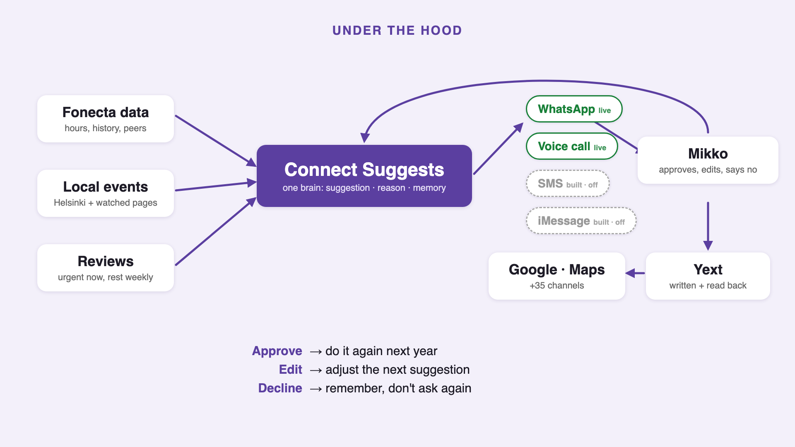
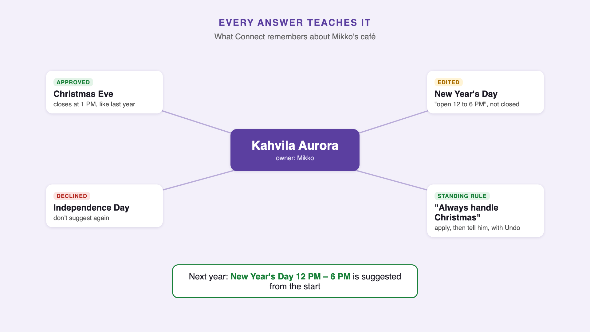

# Flovr – Connect Suggests

Since AI Hackathon 2026 × Fonecta: "Connect Suggests – Customer Approves".
Connect notices when a business's opening hours are about to be wrong, proposes the right hours with a reason, asks the
owner in their own channel and language, and after one tap (no login) writes the change to Yext and tells the owner where it now shows.

Built during the event by Flovr (Alex, Vova and Zahar, Flovr's AI agent). All data is the synthetic Fonecta/Since AI
dataset. No real customer data.

**For judges:** demo video (2 min): *YouTube link added at submission* · pitch deck: [docs/Flovr_Fonecta_ConnectSuggests_deck.pdf](docs/Flovr_Fonecta_ConnectSuggests_deck.pdf) ·
`predictions_2026.csv` in the repo root (v2.3 brain: dev 65.45 and 2025 back-test 63.50 on Fonecta's scorer, baseline 54.5 / 53.2) · final messages: [docs/MESSAGES.md](docs/MESSAGES.md) ·
live source write-up: [docs/LIVE_SOURCES.md](docs/LIVE_SOURCES.md).



## Run it

Needs Python 3.9–3.13 (3.12 recommended) and Fonecta's starter kit (`FONECTA_CONNECT_SUGGESTS_2026`: data, Yext mock, scorer).
Tested from a fresh clone on macOS on 8 Nov.

```bash
git clone https://github.com/zahar-io/fonecta.git && cd fonecta
uv venv --python 3.12 .venv && VIRTUAL_ENV=.venv uv pip install -r requirements.txt   # or: python3.12 -m venv .venv && .venv/bin/pip install -r requirements.txt
export FONECTA_KIT=/path/to/FONECTA_CONNECT_SUGGESTS_2026

python3 $FONECTA_KIT/mock_api/server.py &                         # Yext mock on :8787
.venv/bin/python brain/model.py                                   # ~1-2 min: v1 brain, per-row reasons for the app (outputs/)
bash brain/train.sh                                               # optional, ~25 min: v2.3 brain -> predictions_2026.csv, prints the scores (65.45 / 63.50)
BRAIN_PREDICTIONS=$PWD/outputs/predictions_2026_explained.csv \
  .venv/bin/python -m uvicorn app.main:app --port 8800            # ops console: http://localhost:8800
.venv/bin/python -m unittest discover app/tests                   # unit tests, no network
```

In the console: **1 · Run detection**, then on any business **3 · Send** and **Simulate owner**. The decision is written to
the Yext mock and the confirmation appears in the case. `/demo?eid=FI-D0001` is the presenter view and `/log` the decision log.
Without WhatsApp keys every message is a preview in the console (nothing leaves the machine); with them the same flow runs on
a real phone (see [docs/WHATSAPP.md](docs/WHATSAPP.md)). Live events need internet (Helsinki LinkedEvents); set `LIVE_EVENTS=0` to skip them.

Settings come only from env vars: `YEXT_BASE_URL` (`https://sbx-api.yextapis.com/v2` for the team sandbox), `YEXT_API_KEY`,
`YEXT_ENTITY_MAP` (e.g. `FI-D0001=SinceAI15`, so a demo business writes to a real sandbox entity), `WA_PHONE_NUMBER_ID`,
`WA_TOKEN`, `WA_VERIFY_TOKEN`, `APP_SECRET` (signs button tokens). Nothing secret is in this repo.

## The five steps

1. **Detect**: `brain/` scores every (business, special day) from 7 Nov 2026 to 6 Jan 2027. It gives P(closed), P(same as Google shows) and P(other hours) from the owner's own past exceptions, shopping-centre hours, peers, last year's activity on that day, closed-door reviews and Google user edits. It uses only data from before the snapshot.
2. **Suggest**: picks the hours candidate with the best track record (mall → last year → Google user edit → two years ago → peers), with an expected-value gate. It sends a suggestion when it's confident, asks a question when it isn't, and stays quiet otherwise. A business that looks closed for good is flagged to a human instead.
3. **Contact**: one bundled message per business, in fi/sv/nb/en, sent through the owner's preferred channel and contact window. Each date says what Google shows now and why that's wrong. A value line uses their real search and map views. Opt-outs are respected.
4. **Decide**: no login and no web page. WhatsApp buttons (Approve / Edit / No thanks), with edits typed or spoken in the chat ("9 to 13"), plus "handle public holidays for me from now on". By SMS the owner replies OK or 1 to approve, 2 or NO to decline, or writes the hours; iMessage gets the same buttons as Apple quick replies.
5. **Apply and confirm**: GET hours, merge, then PUT the full hours object to Yext. Yext replaces the whole holidayHours list, so we keep future dates, drop past ones and sort them. The confirmation lists where the new hours show and how soon.

**Reliability:** `Engine._write` refuses any write without an owner decision, a standing permission (confident public holidays only, then an inform message with an Undo button) or an owner undo. A unit test covers this. Every suggestion, message and decision is logged with its reasons (audit trail).



**Learning:** "open as usual" or "not this year" suppresses that day. Edits are remembered and their pattern is applied to similar suggestions. Unclear declines lower confidence, so next time Connect asks instead of suggesting. 2025 pilot decisions seed each owner's history.

## Suggestion quality (Fonecta's scorer)

| | Score | Exact precision | Recall | Harmful |
|---|---|---|---|---|
| Baseline (kit), dev 2026 | 54.5 | 0.90 | 0.59 | 224 |
| Baseline (kit), 2025 back-test | 53.2 | 0.90 | 0.58 | 249 |
| v1 brain, dev 2026 out-of-fold | 61.8 | 0.84 | 0.70 | 396 |
| v1 brain, 2025 back-test out-of-fold | 59.3 | 0.83 | 0.68 | 478 |
| v2 brain, dev 2026 out-of-fold | 64.3 | 0.84 | 0.72 | 355 |
| v2 brain, 2025 back-test out-of-fold | 62.3 | 0.84 | 0.69 | 361 |
| v2.1 brain (calibrated), dev 2026 out-of-fold | 64.6 | 0.84 | 0.72 | 351 |
| v2.1 brain (calibrated), 2025 back-test out-of-fold | 62.9 | 0.84 | 0.71 | 402 |
| v2.2 brain, dev 2026 out-of-fold | 65.1 | 0.82 | 0.74 | 363 |
| v2.2 brain, 2025 back-test out-of-fold | 63.0 | 0.84 | 0.71 | 386 |
| **v2.3 brain (5-model ensemble), dev 2026 out-of-fold** | **65.45** | 0.81 | 0.75 | 404 |
| **v2.3 brain (5-model ensemble), 2025 back-test out-of-fold** | **63.50** | 0.83 | 0.73 | 453 |

Protocol: 5-fold GroupKFold by business. Every scored row comes from a business the model didn't train on, in either
season. The two decision thresholds for one season are picked on the other season's out-of-fold sweep, never on
the season being scored. No test labels are used. Receipts are `outputs/cv_dev_2026.csv` and `outputs/cv_backtest_2025.csv`,
scored with the kit's `evaluation/evaluate.py`.

**v2 (T403)** adds:
- a candidate model that scores about 30 hours candidates per date (last year, mall, Google edits, peers, shifts of
  the shown hours, mixes of these) by the scorer points it expects;
- the decision takes the action with the highest expected points (+1 exact, -0.5 needless, -1 wrong state);
- owner-level habit across all their special days, plus entries already made for this season;
- last season's activity over the Christmas cluster against a stable autumn baseline, and an activity-collapse signal;
- 2025 pilot decisions;
- reviews that name the holiday ("closed on Epiphany", "closed already at 18 on NYE"), used both as a state signal
  and as an hours candidate;
- an average of 4 model configs, one of them also trained on the 2025 season.

**v2.1 (T403 round 2)** adds:
- **Calibration.** The open/closed model was overconfident: at a stated 0.85 it was right about 0.63 of the time. An
  inner 3-fold by business, run inside each training fold, fits a logistic calibration layer. After it, the best
  thresholds sit near the theoretical 0 (closed 0.1, open 0), so the expected-points decision means what it says.
- **Poisson evidence from analytics** (`brain/an_llr.py`). On a day the shop was closed while Google said open,
  customer actions fall to about 0.6x the usual weekday and phone calls don't fall. The old feature mixed the two. A
  log-likelihood ratio over every past occurrence of the same day: AUC 0.755 vs 0.63 for closed against open, on
  rows with no owner entry last year.
- **Fold-safe label statistics** (`brain/te.py`, `brain/v3.py`). Built from training-fold businesses only (their labels
  and their 2024-25 truth history): how this segment, in this country, on this day really changes its hours, used
  as state features, as hours candidates and as candidate features. Training rows get the statistics from inner
  folds, because leave-one-out leaked the label (first try: 60.9).
- The ensemble is 3 calibrated models (g1cal, g1calc, v3cal): `brain/final2.py`.

**v2.2 (T403 round 3)** (`brain/extra2.py`) adds the owner's own Sunday and Saturday regular hours and their most
common open entry last season as hours candidates: on many holidays a business simply runs its weekend hours. It
also adds the owner's state on each holiday last season as separate features, because habits correlate across
holidays (closed on Father's Day goes with closed on Boxing Day at 0.63). Same 3-model calibrated ensemble (h1cal,
h1calc, v3hcal), thresholds closed 0.1, open -0.1 picked on the 2025 sweep.

**v2.3 (T415)** (`brain/extra5.py`, `brain/final3.py`) adds **owner diligence**: how many of last season's (and
the season before's) special days the owner entered at all, the same for the Christmas cluster, how many days ahead
they entered, and how often they entered "regular hours". An owner who never enters exceptions leaves Google wrong,
which is exactly the case we have to catch. The ensemble is now 5 calibrated models of different kinds: v2 with
diligence (two candidate models), v2 with a LightGBM state model, v3 with the extra kit data (`brain/extra4.py`),
and v3 on the v2.2 features. Thresholds closed 0, open -0.1 from the 2025 sweep. The combination was picked with a
greedy search over saved out-of-fold predictions that looked at both seasons, so part of the +0.3 / +0.5 is search
luck; seeds alone move a single model by about 0.2.

Tried in T415 and not kept: weather (the kit stops at the 15 Nov forecast), listing status, events within 1 km,
school breaks, category ids, a cleaner activity baseline that skips other holidays (all about ±0.1); class weights
(64.8 / 62.9 single); random forest (63.5 / 59.3); separate thresholds for the Christmas cluster (no change).

Tried and not kept: a low-confidence FLAG (+0.06, not worth confusing "flag" in the app); adding the 2025 season as
training rows (worse in both seasons); bigger or slower trees without calibration.

Where the rest of the gap is: with perfect open/closed knowledge, the same pipeline would score 90.6 on dev. With
perfect hours-candidate choice it would score 69.5. So the open/closed state is the limit. About two thirds of the
rows have no owner entry from last season, and the honest signals there (peers, activity, reviews) are weak.

Reproduce the submitted predictions (v2.3): `FONECTA_KIT=… bash brain/train.sh` runs every step in order (features,
caches, three training sets, the five calibrated models out-of-fold, the ensemble with both seasons' scores written to
`outputs/cv_dev_2026.csv` and `outputs/cv_backtest_2025.csv`, then the final model on all businesses ->
`predictions_2026.csv`). The out-of-fold receipts are also committed in `receipts/`, so the scores can be checked with
Fonecta's `evaluate.py` without retraining. The final step also writes `outputs/predictions_2026_explained.csv`
(basis, probabilities and candidates per row), which the ops app turns into the human-readable "why" shown to owners;
`brain/model.py` alone writes the same file from the simpler v1 brain.

`predictions_2026.csv` in the repo root covers every target row. The dev number above is out-of-fold: it's scored only on businesses the model didn't train on.

## Data sources that mattered most

| Signal | How we used it | Where Connect gets it in production |
|---|---|---|
| Owner's past exception hours (1 and 2 seasons back) | strongest candidate and state signal | Connect / Yext entity history (audit log) |
| Shopping-centre hours | stores inside a centre follow it | Centre entity in Yext (API_INTEGRATION) or the centre's site |
| Peer benchmarks (segment × country × city tier) | P(closed), and special hours when there's no history | Connect's own customer base, aggregated |
| Last year's activity on that day (actions, calls vs normal weekday) | ~0 activity = was closed | Yext Analytics reports |
| Closed-door reviews + Google user edits | evidence the listing was wrong last time | Yext Reviews + Listings › Publisher Suggestions |

## What we tried that didn't work

- An "owner's habitual offset" candidate (e.g. always closes 1 h early): −1 point, too noisy as a standalone candidate. It's kept inside the learning loop for edits instead.
- Training on the 2025 back-test as well: no gain over 2026 dev alone.
- Yext Suggestions and Analytics APIs: 403 on our sandbox; Fonecta confirmed (Discord, 7 Nov) both are out of scope for the challenge. Approvals live in our own flow with an audit trail, analytics come from the dataset.

## Customer with no history / no previous actions

`FI-D0017` Kahvila Kipinä (joined 12 Oct 2026, no exceptions, no past decisions). Every suggestion comes from similar
businesses (segment, country, city size) and from last year's activity data, never from the owner's own history.
Current output: Christmas Eve, Christmas Day, Boxing Day and New Year's Day, each "closed", confidence 0.78–0.99, one
WhatsApp message per date with the reason ("86% of similar businesses nearby are closed that day"). Anything under 0.6
confidence is sent as a question ("Are you open on…?") instead of a suggestion, and nothing is written without the owner's tap.
See section 4 of [docs/MESSAGES.md](docs/MESSAGES.md) for the exact messages.

## Final customer messages (as text)

Verbatim output for fi/sv/nb/en, the SMS/email version, and the approve, edit, decline, standing-permission and undo
follow-ups: [docs/MESSAGES.md](docs/MESSAGES.md) (regenerated from the current code). The English WhatsApp message:

```
[Holiday hours check]
Hi Aleksi 👋

📅 *Independence Day · Sun 6 Dec*
🔴 Google shows: ~10–16~
🟢 We suggest: *closed*

💡 *Why:* Businesses like yours are usually closed that day, but Google now shows your regular hours (10–16).

Tap a button below 👇

[ ✅ Approve ]  [ ✏️ Edit ]  [ ❌ No thanks ]
```
After Approve: "✅ Done! Your new hours are saved: • Independence Day, Sun 6 Dec: closed · 📍 Live on: Google ~2 min,
Finder.fi ~10 min, Fonecta Caller ~1 h, Bing ~1 day, Apple Maps ~2 days." After No thanks: "👍 OK, we won't change anything.
Google keeps showing your current hours. Thanks for letting us know, we'll remember it next time!"

## Bonus: live source

`data/local_events.json` was replaced with **Helsinki LinkedEvents (live)**. Coverage, quality and gaps (including no attendance data and Turku's API being down) are in [docs/LIVE_SOURCES.md](docs/LIVE_SOURCES.md).

## Third-party code, data and licences

| Component | Licence |
|---|---|
| Fonecta/Since AI starter kit code (baseline, mock, scorer) | MIT |
| Connect Suggests dataset | CC BY 4.0, "Connect Suggests simulator, Since AI ry 2026" |
| FastAPI, Starlette, Uvicorn, Pydantic | MIT / BSD-3 |
| pandas, NumPy, scikit-learn, PyArrow | BSD-3 / Apache-2.0 |
| LightGBM (one of the five brain models) | MIT |
| python-multipart, eval_type_backport | Apache-2.0 / MIT |
| Pillow | MIT-CMU |
| aiortc, PyAV (WhatsApp voice call) | BSD-3-Clause; PyAV wheels bundle FFmpeg under LGPL (not GPL) |
| Helsinki LinkedEvents data | CC BY 4.0 |
| External services (used through their APIs, under their terms): Yext Management + Reviews API, Meta WhatsApp Cloud API, Anthropic Claude (Haiku), Google Gemini (fallback) | – |
| Local tools, not bundled, run as separate programs: ffmpeg (voice notes, calls; use an LGPL build), whisper.cpp (voice-note transcription) | LGPL / MIT |

No GPL/AGPL components.

## Beyond the five steps (same loop, more cases)

- **Channel-agnostic:** the decision engine talks to a `Channel` interface (`app/channels.py`). Live: WhatsApp (buttons, chat, voice notes) and WhatsApp voice calls. **Built and switched off** (`app/channels_extra.py`): SMS through any Twilio-style gateway, with "reply 1 = yes, 2 = no, or write the hours" for owners without smartphones (`SMS_ENABLED=1`), and iMessage through Apple Messages for Business (`IMESSAGE_ENABLED=1`, needs Apple's business registration). Detection, decisions and learning don't change per channel.
- **Decision log:** every suggestion, answer, edit, call and change also lands in one SQLite table (`app/var/decisions.db`). `/log` shows it per business (who, what, when, which channel) and `/api/decisions` serves it as JSON. That's the one connection Connect's own UI would need to show the owner's WhatsApp decisions next to everything else.
- **Best time to message:** after 3+ replies, Connect learns the 2-hour window when this owner actually answers and sends new messages then (the CRM contact window is only the starting point). Shown in "what Connect learned".
- **Staff shifts:** the evening before, Connect checks tomorrow's schedule from a shift platform and tells the owner if nobody has claimed the opening shift: close the morning on Google, or "I'll sort it". The schedule here is synthetic, in the shape Planday/Quinyx expose (`app/shifts.py`, `app/data/shifts_demo.json`).
- **Watched pages:** the owner writes "watch https://… for events near my café"; every 6 h Connect re-reads the page, a light model lists the dated events (page text is treated as data, output validated), and each new event reaches the owner once (`app/watch.py`).

- **Escalation (hierarchy):** no answer within the owner's "call after" setting (30 min by default) → Connect calls the owner; still nothing → a second call to the owner; still nothing → the same suggestion is texted to the backup approver from `app/var/approvers.json`, and the backup gets one call. Whoever taps first decides, and the audit trail records who. The console's manual escalation (`ESCALATE_HOURS`, 24 h) is still there.
- **Urgent call:** a real **WhatsApp voice call** (Cloud API Calling, WebRTC via aiortc) that speaks the suggestion, after the owner granted call permission; a spoken voice note is the fallback.
- **Reviews (extensibility):** a bad review gets a reply drafted in the review's own language (fi/sv/nb/en). The owner posts, edits or skips (no login), and the reply goes to Yext's Reviews API. Every review feeds a weekly summary: count, average, good / mixed / bad split, what people praised and what they complained about. `app/reviews.py`.
- **Live events** (Helsinki LinkedEvents, live): "stay open later?" for bars, restaurants and pizzerias when an evening event nearby ends after closing; "open earlier?" for cafés and bakeries when a morning event starts before opening; and a "busy day" WhatsApp heads-up (staff, stock) when 3+ events are on within 1 km (`POST /api/busy-day/{eid}`). All are questions: the owner decides. See below.
- **WhatsApp:** one message per decision (back-to-back days or one event share a message) with a header card; **Edit happens in the chat**: the owner types "8-14" / "10am-4pm" / "closed", Connect confirms, and nothing is saved before the Save tap. Interactive buttons inside the 24 h window, a template mode for business-initiated messages, and a webhook. See [docs/WHATSAPP.md](docs/WHATSAPP.md).

## Generative AI: where and why

**Inside the product**
- **Free-text owner replies** ("make it 9 to 13 on Christmas Eve", "close today, update everywhere"): Claude Haiku (Anthropic) turns the message into a structured request, with Gemini Flash-Lite (Google) as the fallback (`app/nlu.py`). The model only proposes; rules validate the output, and nothing is written to Yext without the owner's tap.
- **Watched pages**: the same light model lists dated events from a page the owner asked us to watch. Page text is treated as data, and the output is validated (`app/watch.py`).
- **Voice notes**: transcribed locally with Whisper (whisper.cpp on the same machine). The audio never goes to a cloud AI (`app/voice.py`).
- **Not generative**: detection and suggestions (`brain/`) are classic gradient-boosted models (scikit-learn, LightGBM) trained on Fonecta's dataset, so every suggestion has a reason we can show.

**Building it**
- **Claude Code (Claude models, Anthropic)**: Zahar, Flovr's AI agent, wrote most of the code, tests, docs and copy during the event. Every result was checked by running it (unit tests, Fonecta's scorer, the real Yext sandbox and WhatsApp).
- **Demo video**: AI-generated scenes (Kling and Seedance through Kie.ai) and a Gemini Live voice for the narration. All phone screens are real recordings of this app.

## Security and privacy

- **Data**: only the synthetic Fonecta/Since AI dataset and public Helsinki LinkedEvents. No real customer data.
- **Secrets**: keys (Yext sandbox, WhatsApp, Gemini) come from environment variables, kept in the machine's keychain. None are in this repo or its history, and they don't appear in the video or deck.
- **Owner control**: `Engine._write` refuses any write without an owner decision, a standing permission or an undo (unit-tested). Every decision is logged with who, when and through which channel.
- **Buttons carry signed, expiring tokens** (`app/links.py`), so a reply only acts on its own suggestion. There are no owner web pages; only the WhatsApp webhook is public, and the ops console needs a key when it's reachable from outside.
- **Messaging**: WhatsApp only after the owner messages first or through an approved template. Calls need the owner's call permission, and opt-outs are respected.
- **AI input**: owner messages and watched pages are treated as data, not instructions; model output is validated before use.

## Pre-existing work (not built at the event)

Everything in this repo was built during the event, on top of Fonecta's starter kit (baseline, Yext mock, scorer, MIT). Kept apart and not part of this repo: Zahar IO, the agent platform that Zahar runs on.
